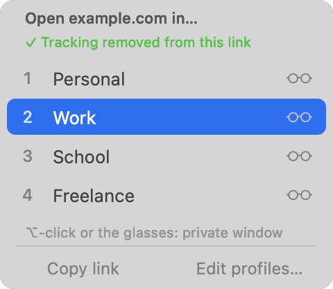
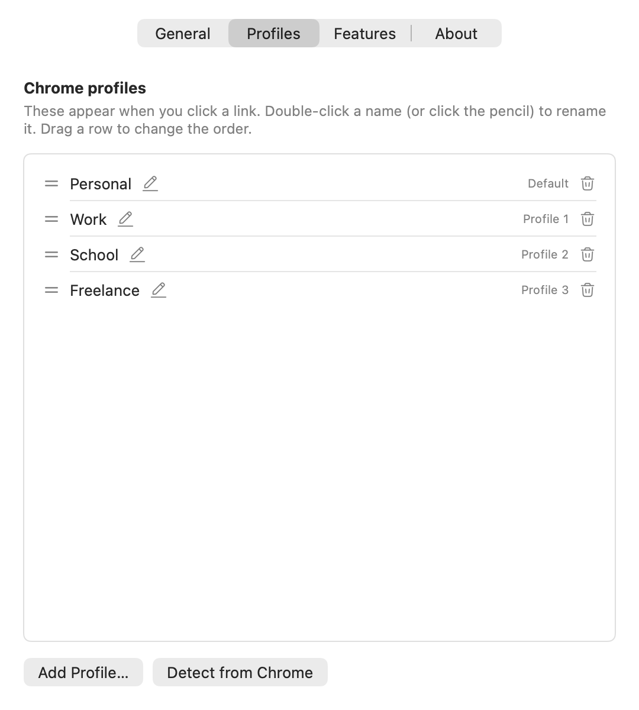

# WhichProfile

[](LICENSE)


**Choose which Chrome profile opens a link on macOS.**

Click a link in Slack, Mail, Notes or any other app and a small popup appears next to your cursor asking *which profile?* Pick one with the mouse or the number keys, and the link opens there. No more links landing in the wrong Google account.

<p align="center">
  
</p>

## Features

- **A profile picker for every link.** The popup appears at your cursor, stays on screen, and quits when you are done, so nothing runs in the background.
- **Private windows.** Click the glasses on a row, or hold <kbd>⌥</kbd> while choosing, to open the link in a private window of that profile.
- **Copy link.** Copy the link instead of opening it (<kbd>⌘C</kbd>).
- **Tracking removal.** Strips `utm_*`, `fbclid`, `gclid` and similar parameters before the link opens, and tells you when it did. Turn it off in Settings.
- **Remembers your last choice.** The profile you used last is highlighted, so Return reopens it.
- **A settings window, not a config file.** Rename, reorder, add and remove profiles, detect them from Chrome, and see at a glance whether it is your default browser.
- **Private by design.** No network access, no accounts, no analytics. Links are never stored or logged.
- **Free and open source** (MIT). Native Swift, no dependencies.

## Install

WhichProfile is built from source (prebuilt releases are planned).

**Requirements:** Google Chrome and the Xcode command-line tools (`xcode-select --install`); full Xcode is not needed. The app targets macOS 12 or later, but has so far only been tested on a recent macOS release. Reports from other versions are welcome.

```bash
git clone https://github.com/arverma/WhichProfile.git
cd WhichProfile
./build.sh
```

This builds the app, signs it ad hoc, and installs it to `~/Applications/WhichProfile.app`. If macOS blocks the first launch:

```bash
xattr -d com.apple.quarantine ~/Applications/WhichProfile.app
```

## Quick start

Open **WhichProfile** from Spotlight. The **General** tab walks you through three steps:

1. **Make it your default browser** (one button; macOS asks you to confirm).
2. **Add your Chrome profiles** in the **Profiles** tab, using **Detect from Chrome** or **Add Profile…**.
3. **Click a link in any other app.**

<p align="center">
  
  
</p>

## Using the picker

| Action | How |
|---|---|
| Open in a profile | Click it, or press `1`–`9` |
| Move the selection | `↑` / `↓`, or hover |
| Open the selected profile | `Return` |
| Open in a **private window** | Click the glasses, or hold `⌥` with any of the above |
| Copy the link | **Copy link** button, or `⌘C` |
| Edit your profiles | **Edit profiles…**, or `,` |
| Dismiss | `Esc`, or click elsewhere |

Links clicked *inside* Chrome never go through the default browser, so they are not intercepted.

## Settings

The window has four tabs: **General** (setup checklist and options), **Profiles** (rename by double-click or the pencil, drag to reorder, remove with the trash icon after a confirmation, **Add Profile…**, **Detect from Chrome**), **Features** (everything the app can do, with shortcuts) and **About** (version, privacy, links, copyable diagnostics). Changes save automatically.

### Finding your profiles

macOS protects other apps' data, so WhichProfile may not be able to read Chrome's profile list on its own. You have three options:

1. **Detect from Chrome** in the Profiles tab. If macOS blocks the read, you are asked to select Chrome's data folder (`~/Library/Application Support/Google/Chrome`), which grants access.
2. **Add Profile…** and enter each profile's directory. In Chrome, open the profile, go to `chrome://version` and take the last part of "Profile Path" (for example `Default` or `Profile 3`).
3. **Full Disk Access** for the app (System Settings → Privacy & Security). This is a broad permission, so options 1 and 2 are preferred.

## Configuration file

Settings are stored in `~/.config/whichprofile/config.json`. You never need to edit it by hand, but you can. Every key is optional:

```json
{
  "profiles": [
    { "dir": "Default",   "name": "Personal" },
    { "dir": "Profile 1", "name": "Work" }
  ],
  "rememberLast": true,
  "cleanLinks": true
}
```

| Key | Meaning |
|---|---|
| `profiles` | The profiles to offer, in order. `dir` is Chrome's directory name |
| `rememberLast` | Pre-select the last-used profile (default `true`) |
| `cleanLinks` | Remove tracking parameters from links (default `true`) |
| `hidden`, `order`, `labels` | Older hand-written alternatives: hide profiles, reorder them, rename them. The settings window folds these into `profiles` the first time you change something |

Environment variables for development: `WHICHPROFILE_CONFIG` (config path) and `WHICHPROFILE_LOG` (log path).

## Command line

The app's executable has a few options, useful for debugging or when you prefer the terminal:

```bash
~/Applications/WhichProfile.app/Contents/MacOS/WhichProfile --list-profiles   # print the profiles it would show
~/Applications/WhichProfile.app/Contents/MacOS/WhichProfile --setup           # edit profiles in a terminal menu
~/Applications/WhichProfile.app/Contents/MacOS/WhichProfile --help
```

## Privacy

WhichProfile runs entirely on your Mac. It has no network access, no accounts, no analytics and no tracking. The links you click are handed to Chrome and are never stored. Its log (`~/Library/Logs/WhichProfile.log`) records which profile was used, never the link. The whole app is under 2,000 lines of Swift, so you can read exactly what it does.

## How it works

The app registers for `http` and `https` links. When one arrives it shows the popup at the mouse position and then runs:

```bash
open -na "Google Chrome" --args --profile-directory="Profile 1" [--incognito] "<link>"
```

The `-n` flag is what makes Chrome honour `--profile-directory` even when it is already running.

## Troubleshooting

| Problem | What to try |
|---|---|
| Links open in Chrome without a popup | WhichProfile is not your default browser. Open it and use **Make Default…** on the General tab |
| The popup shows an orange "Add your profiles" note | It could not read Chrome's profile list. Add profiles in the Profiles tab |
| A private window does not open | Chrome profiles managed by an organisation can block private windows. Chrome decides, not WhichProfile |
| A profile does not open | Check its directory in `chrome://version`. Run `--list-profiles` and read `~/Library/Logs/WhichProfile.log` |

Still stuck? Open an [issue](https://github.com/arverma/WhichProfile/issues) and paste the text from **About → Copy diagnostics** (it contains no links or names).

## Project layout

```
Sources/      app code: popup, settings window, profile list, link cleaning, launcher, setup
Resources/    Info.plist, app icon and settings icons
Scripts/      app icon generator
Tests/        dependency-free tests (Tests/run.sh)
docs/         screenshots
build.sh      build and install
VERSION       version number, stamped into the app by build.sh
```

## Development

```bash
./Tests/run.sh   # logic tests
./build.sh       # build and install
```

The logic (profile parsing, config, link cleaning, launch arguments, the editable profile list and `--setup`) is covered by tests. The popup and settings window are not, so please try them by hand. See [CONTRIBUTING.md](CONTRIBUTING.md) before opening a pull request.

## License

MIT, see [LICENSE](LICENSE). Chrome is a trademark of Google LLC. WhichProfile is an independent project and is not affiliated with or endorsed by Google.
